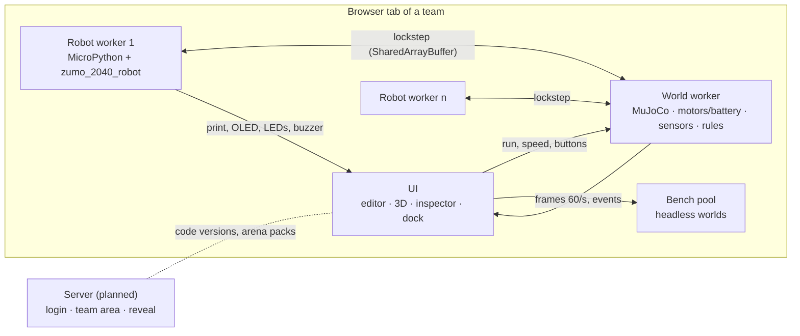

# SPARK Sim — architecture and plan

Status 15 Oct 2026, prepared for the software team meeting on 22 Oct 2026. The prototype in this repository
runs (`npm install && npm run dev`) and all checks pass (see "Verified").

## What it is for

At the triathlon, teams get their Zumo 2040 only a few hours before Challenge 1. Until then the simulator is the
only thing they can practise on. Three requirements follow:

1. **Same code.** The program that runs in the simulator runs unchanged on the robot and vice versa.
2. **Same behaviour.** What works in the simulator works on the real board: speed, sensor values, loop timing,
   pushing, tipping, memory.
3. **On their own.** Every team has its own area and can load any number of robots (own versions, house bots).
   Teams never play against each other in the simulator — that happens at the event, so it stays exciting.

For us game developers it is also the lab: compare strategies, test arenas and rules (Challenge 1 is still open),
and later judge real matches from the camera with the same rules code.

## Decisions so far

| # | Decision | Why |
|---|---|---|
| 1 | **Rebuilt from scratch**; the old 2D sim (`02_triathlon/tracking/sim`) remains a reference for numbers | 2D cannot tip, lift with the blade or model height; it ran programs in CPython instead of MicroPython |
| 2 | **Everything simulates in the player's browser.** The server only does login, team area and unlocking content | No latency, works offline, costs us no compute. No cross-team play, so the server never runs matches |
| 3 | **Real MicroPython**, our own WebAssembly build (`vendor/micropython`) | Same language, same libraries, same errors, same heap limit (~190 KB) and garbage collection as the RP2040 |
| 4 | **MuJoCo** (DeepMind's official WebAssembly bindings) for physics | Research-grade 3D contacts and friction, deterministic, faster than real time in the browser |
| 5 | **TypeScript, Vite, three.js, CodeMirror** | One language for world, UI and tests; the world runs identically in the browser and in Node (benches, CI) |
| 6 | **Rules are public**; hidden are only unreleased challenge content, house-bot code (later as `.mpy`) and other teams' code | Whoever is judged must know how |
| 7 | **Design like spark-hpi.de**: colours, Departure Mono, pixel texture, star logo; dithered 3D view | One look for club, website and tools |
| 8 | **Deterministic per seed** (physics noise, start spread, Python `random`, button presses at exact sim times) | Every bench match can be replayed exactly; results are reproducible for everyone |

## Architecture

**Lockstep, the core.** Every robot has its own simulated clock. Its program runs freely until it needs the world
(sensor, motor, `sleep`) or has used 1 ms of CPU time. Then it writes clock and request into shared memory and
blocks. The world serves all requests strictly in time order (ties by slot): it advances the physics to that
moment, answers and wakes the robot. Consequences:

- Every program sees the world exactly at its own time; results do not depend on the computer's speed.
- CPU time costs like on the RP2040: the VM counts executed bytecodes (≈ 1.7 µs each, EST) and every sensor
  access has its real duration. Library internals that the original runs as viper code or in the PIO are not
  charged twice ("untimed" sections).
- A request that takes time (proximity: 12 pulses over 6.85 ms) is sampled in its middle and answered at its end.
- A watchdog detaches a program that has not touched the world for 5 s of wall time (a statement that never
  returns), so the others keep running.
- Scheduled button presses (the start signal, test presses) are known to the robot in advance and read from its
  own clock; only live presses from the UI go through shared memory. Replays and bench matches are therefore
  exactly reproducible (verified: 8 of 8 parallel runs identical to the millisecond).
- `machine.Timer` and `micropython.schedule` work like interrupts: the VM's bytecode hook raises a timer
  interrupt at the due robot time and MicroPython's own scheduler runs the handler at the next bytecode check —
  also in `while not done: pass`. Callbacks always cost robot time; an exception in one is printed and the
  program goes on (like MicroPython's scheduler).

**Rules engine** (`src/world/rules.ts`): positions in, events and scores out; evaluated inside the world every
5 ms and immediately when a robot leaves the arena. The same code is meant to judge real matches from the
camera tracking later. Like a real bout, sumo, King of the Hill and shuttle start with a **start signal** (UI:
⚑ Start or "Auto start"; it presses A on every robot): phases waiting → countdown (5 s) → running → over; the
match clock, the time limit, zone time and shuttle points count from go, a sumo robot that moves before go is a
false start. The race times every robot from its own first crossing and ranks the total of 3 timed laps, so the
start slot does not matter. Stop ends judging (the score freezes).

**Important files**

| File | Role |
|---|---|
| `src/shared/zumo-spec.ts` | All numbers of the Zumo with their source (DB, STEP, DER, EST). Calibration only touches this file |
| `src/shared/protocol.ts` | Lockstep protocol, messages, world tweaks |
| `src/shared/arenas.ts` | Arena = physics geometry + IR reflectance + picture + rule geometry, from one definition |
| `src/world/mjcf.ts` | MuJoCo model: hull, blade, tracks as 4 coupled rollers per side |
| `src/world/world.ts` | Motor and battery model, sensors (ray casts), scheduler, watchdog |
| `src/world/rules.ts` | Sumo, race, king of the hill, shuttle, free |
| `src/robot/runtime.ts` | Starts MicroPython, bridge to the world, CPU time |
| `src/robot/python/` | `_spark_rt.py` (runtime, timers), `_spark_time/machine/rp2/micropython.py`, `zumo_2040_robot/robot.py` |
| `src/ui/bench.ts` | Parallel headless match pool, bench statistics, round robin |
| `vendor/micropython/` | Custom MicroPython build (synchronous GC, fixed heap, bytecode hook), see `BUILD.md` |

**Track trick.** The rollers have the track's outer radius (correct ground clearance); torque, speed, encoder
counts and rotor inertia are converted to the sprocket's pitch circle (correct driving speed).

## Fidelity: what is modelled and where the numbers come from

Every number in `zumo-spec.ts` carries a source tag: **DB** datasheet/Pololu library, **STEP** Pololu's CAD
model, **DER** derived, **EST** estimate to be calibrated.

| Area | Modelled | Notes |
|---|---|---|
| Drive | DRV8838 slow-decay average model, back-EMF braking (implicit joint damping), gearbox friction as static friction (implicit), rotor inertia, ±4 % unit spread | top speed 0.645 m/s (Pololu ~0.65); a braked robot stays put (≤ 0.05 mm in 2 min) |
| Battery | 4 × NiMH, internal resistance, state of charge; selectable 100/60/25/0 % | sag under load visible in telemetry |
| Contacts | MuJoCo: track grip μ 1.0 (EST), blade wedge lifting, tipping; floor grip selectable | the dohyo is a cylinder, so roller contacts use MuJoCo's generic convex path (one point per roller); stable in all tests, revisit with calibration |
| Blade | inclined plate with a rounded lower edge (capsule); per robot from the seed: edge height 0.4 ± 0.1 mm and tilt across the width ± 0.3 mm (EST) | head-on, the blade that is lower where the two meet gets under the other, independent of motor power; see the note below |
| Line sensors | ray cast to the printed surface, light spot of ~5 mm (13 weighted samples), reflectance, height falloff, per-sensor gain spread; read always 1.06 ms | white ~110, grey ~300, black 1024; a tape edge ramps over ~3 mm (107 → 150 → 327 → 1024); a lifted sensor reads 1024 like black, as on the robot |
| Proximity | ray fan from the receivers (13 mm high, 61 rays each, one `mj_multiRay` call per receiver) with both LED groups' cones, material reflectance, 6 levels, custom levels/pulse times | frontal Zumo: 6 at 5 cm … 1 at 35 cm; one ray per call cost 14× more and made proximity 46 % of the world thread |
| IMU | acc/gyro from the rigid body + noise and bias, magnetometer from an earth field; ODR 52/208/10 Hz, `data_ready()` | axes x forward, y left, z up (verify sign on hardware) |
| Timing | bytecode counting, sensor durations, display 4 ms, timers as VM interrupts; `time` functions cost about what the C versions cost on the robot | long C calls (`sum(range(10**6))`, `gc.collect()`) count as one bytecode: far too cheap |
| Memory | fixed heap ~212 KB incl. the simulator's runtime modules, real GC | `MemoryError` like on the robot |

**Head-on blade contact (found by the house-bot matrix, fixed 16 Oct).** The blade used to be a plain box. When two
box corners touch, MuJoCo takes one box's end face as the contact normal; that face is tilted 40°, so the robot
owning it (the first in geom order) was pushed up, and the harder a robot pushed, the higher it climbed. Result:
"push gently and you win" — a trick that would not work on real robots. Now the lower edge is a capsule: two
edges push along the line between them, horizontal at equal heights. That equilibrium is unstable (as with real
blades), so tiny differences decide; without a spread it was the nose-up pitch while accelerating (0.03 mm), which
again favoured the slower robot. Real robots differ by tenths of a millimetre in blade height, so every robot first got a
blade height from the seed: power no longer mattered (the lower blade was lifted in 112 of 114 test duels), but
then the seed alone decided 73 % of all sumo matches — a hidden lottery. Real blade edges are also not level, so
each robot now gets a mean height (0.4 ± 0.1 mm) and a tilt across its width (± 0.3 mm, EST): which blade is lower
depends on where and at which angle the robots meet, which the programs control. Power still does not decide
head-on duels (20 seeds each: 6000 vs 3000 pushes 13:7, 3000 vs 6000 9:11, 6000 vs 6000 11:9). This must be
checked on real robots.

## Verified (all automated)

- `npm test` — world: speed, encoders, battery, line on black/white/grey, IMU at rest, proximity curve head-on
  and to the side, ring-out judging, pushing duel, race lap (incl. checkpoints: a shortcut counts no lap),
  king-of-the-hill timing.
- `tests/runtime-check.ts` — 16 checks with real programs: line read duration, custom proximity levels, gyro at
  208 Hz via `data_ready()`, IMU disabled/ValueError/`to_gauss`, timers in busy loops, `from time import *`,
  clean tracebacks, partial output lines, seeded `random`, shared motor state, display API, deterministic replay,
  watchdog, garbage collection under churn, `MemoryError` on a leak.
- `tests/mp-build-check.mjs` — the MicroPython build: GC in one long call, hard heap limit, settrace, JS bridge,
  framebuf, modules, bytecode hook, GC torture, nested calls, the real runtime on the build.
- The MicroPython build passes MicroPython's own test suite (826/835; the rest are documented harness
  differences), also with a collection on every allocation.
- A deep code review (physics, lockstep, library vs. the Pololu original, UI) — all 23 findings fixed or
  documented below.
- A second audit (2026-10-16) of the robot runtime, the world and the UI with browser repro scripts: robots
  started before the start signal (Auto A on by default, Space re-activating the last clicked button, Space in
  the docs starting a match), keyboard focus, corrupted browser storage, GPU memory, layout at 1024–1440 px,
  bench cancel/time column, WATCH exactness — all fixed and re-checked in Chrome.

## How to extend

- **New arena / Challenge 1 format:** add a factory in `src/shared/arenas.ts` (geometry, `reflect`, `color`,
  starts, `isOut`, rule geometry) and, if it needs new scoring, a `case` in `Rules.step()`. House bots for it go to
  `src/bots/<mode>/`. The UI, bench and headless runner pick it up automatically.
- **New sensor / shop part:** an operation in `protocol.ts`, its handling in `World.serve()` (with its real
  duration), the Python side in `robot.py` or a new module, a check in `tests/runtime-check.ts`.
- **New house bot:** a `.py` file in `src/bots/<category>/` with the header (`# Name:`, `# Strategy:`,
  `# Strengths / weaknesses:`, `# Tests:`, `# Arena:`, `# Difficulty:`). Wait for button A, then 5 s, like players.
- **New number:** into `zumo-spec.ts` with its source tag.

## Known gaps

| Gap | Effect | Way forward | Package |
|---|---|---|---|
| **No calibration yet** (all EST values) | details differ from the real robot | measurement protocol from the old sim with real Zumos, then fit automatically: same program on the real board under the tracking camera and in the sim, compare trajectories | 1 |
| Floats are double precision (RP2040: single) | rare numeric differences | build variant with `MICROPY_FLOAT_IMPL_FLOAT`; clock values must then be passed as integers | 2 |
| Shop parts on I2C (ToF, BNO085, VCNL4200, 8×8 ToF, servos) | `machine.I2C` answers ENODEV | register-level device models, sensor models from the old `sensoren.py` | 2 |
| IR interference between robots, ambient light | proximity too clean with 4 robots | treat other robots' 56 kHz pulses as light sources in the ray cast | 2 |
| Only one program file per robot | no own modules | file tree per robot in the editor, written to the MicroPython file system | 3 |
| No server: code lives in the browser's storage | no team area, no sharing between devices | login with team codes, code versions, run history, reveal of arena packs | 4 |
| Rules not yet fed by the camera | judging at the event is manual | connect `tracking/tracker.py` output to `Rules.step()` | 5 |
| Blade edges not measured | the per-robot blade height (EST ± 0.1 mm) decides 71 % of house-bot sumo matches, mostly in the opening clash; benches need ≥ 20 matches per pairing | measure the edge height at both ends of 5–10 real Zumos with a feeler gauge (10 minutes) and film head-on hits at different powers; then set `bladeGapSpread`/`bladeTiltSpread` | 1 |
| `asyncio` is the browser port's (no `asyncio.run`) | robot programs written with asyncio fail in the sim | an `asyncio` on the simulated clock, like `_spark_time.py` | 2 |
| Garbage collection costs no robot time; world calls allocate (≈ 300 B per line read) | collections run more often than on the robot but are free | measure `gc.collect()` on a real Zumo with a full heap, charge it per collection | 2 |
| Start lines (shikiri) read 1024 like black | on the inverse dohyo they look like the edge band at the start | measure the IR reflectance of the real brown start-line tape | 1 |

## Work packages (five people)

| # | Package | Scope | Next steps |
|---|---|---|---|
| 1 | **Physics and calibration** | `mjcf.ts`, motor/battery in `world.ts`, `zumo-spec.ts`, arenas to real dimensions | measurement night with 2 Zumos and the tracking rig; Spormula E track to plan; blade shape from STEP |
| 2 | **Runtime and sensors** | `src/robot/`, sensors in `world.ts`, `vendor/micropython` | measure µs per bytecode on a real Zumo; single-precision float build; first shop sensors (VL53L4CD, BNO085) |
| 3 | **UI** | `src/ui/`, `main.ts` | multiple files per robot, saved scenarios, usability test with 3–5 players (layout presets, tour, docs), accessibility pass (screen reader, contrast) |
| 4 | **Backend and operations** | server, hosting, CI | hosting with COOP/COEP headers, team login, code versions, reveal system, CI running all checks |
| 5 | **Games and judging** | rules, house bots, statistics | final sumo match flow (3 rounds), Spormula E rules, Challenge 1 candidates with metrics (rank stability, stalemates, lead changes), camera → rules bridge |

## Timeline

| When | Milestone | Content |
|---|---|---|
| 22 Oct | **Kick-off** | decisions, repository, packages assigned, this prototype as the base |
| ~12 Nov | **Calibrated** | measurement protocol done, float build, Spormula E track, team login, CI |
| ~3 Dec | **Beta for players** | shop parts, more house bots, saved scenarios, hosting |
| event − 2 weeks | **Freeze** | fixes only; Challenge 1 pack ready for the reveal |
| event | **Event mode** | rules judge the camera data, replays of real matches in the same viewer |

## Open questions for the meeting

1. **Event date** — decides freeze and scope.
2. **Hosting** — the server must send COOP/COEP headers (GitHub Pages cannot; Cloudflare Pages, Netlify or our
   own server can).
3. **Accounts** — how do teams get their area (codes per team, university login)?
4. **Reveal** — when is Challenge 1 revealed, and who releases the pack?
5. **Real Zumos for calibration** — when and which robots, ideally with the tracking rig.
6. **Final shop list** — which parts are certain? Package 2 follows that order.
7. **House bots** — they should not come from people who also mentor teams.
8. **Conventions** — branch and review rules; everything in English.
